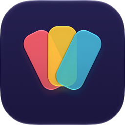
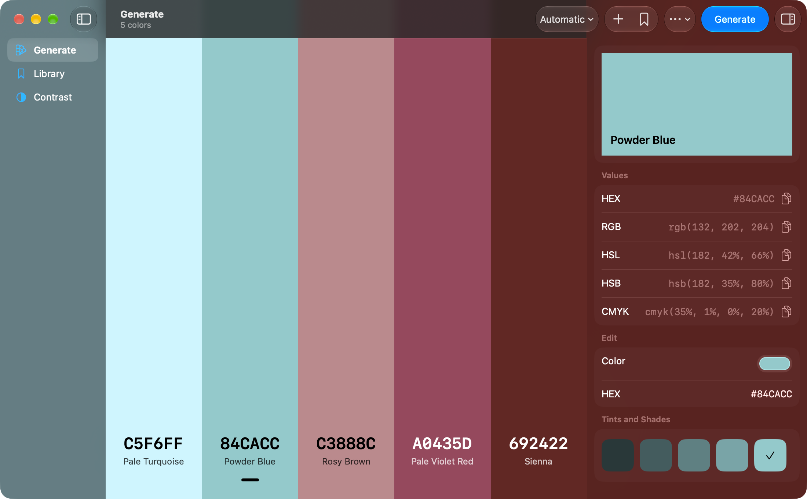
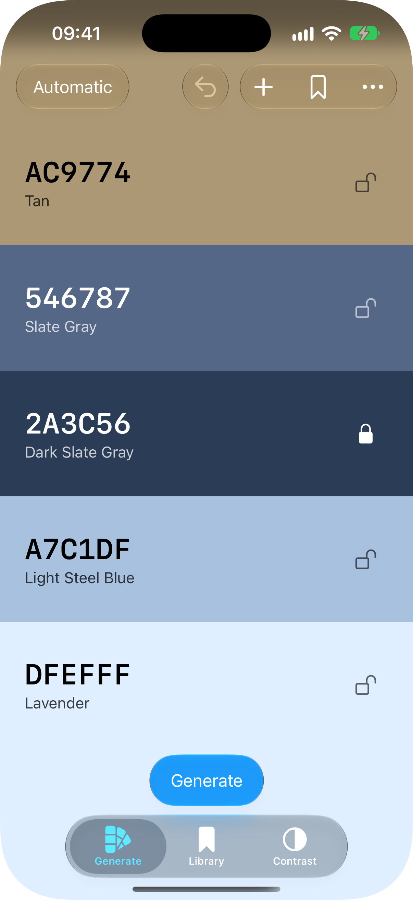

<p align="center">
  
</p>

<h1 align="center">Hueful</h1>

<p align="center">
  A color palette generator for iPhone, iPad and Mac, in the spirit of <a href="https://coolors.co">Coolors</a>.<br>
  One multiplatform SwiftUI app with a Liquid Glass interface, built with <a href="https://github.com/yonaskolb/XcodeGen">XcodeGen</a>.
</p>

<p align="center">
  
  
</p>

## Features

- **Generate palettes**: press Generate (Space or ⌘G on Mac) for a new palette of harmonious colors. Lock the colors you like and only the others change.
- **Harmony rules**: Automatic makes palettes that look like Coolors' (see How it works); Analogous, Monochromatic, Complementary, Split Complementary, Triadic and Square follow the color wheel.
- **Edit the palette**: from 2 to 10 colors. Add Color adds one that fits the others; remove a color with a swipe on iPhone or the × that appears on hover on Mac; drag colors to reorder them. In columns (Mac, and iPhone in landscape) a long press or right-click on a color opens Lock, Copy HEX and Remove.
- **Undo and redo**: generating, adding, removing, moving and loading can be undone, with the Undo button on iPhone and ⌘Z / ⇧⌘Z on Mac.
- **Color details**: tap or click a color for its name, its HEX, RGB, HSL, HSB and CMYK values with a copy button each, a color picker and a HEX field to change it, nine tints and shades to pick from, and the nearest RAL, HKS and Prismacolor colors. On Mac they open in the inspector.
- **Colors from a photo**: Colors from Photo… (iPhone, from the photo library) or Colors from Image… (Mac, ⌘O, from a file) replaces the palette with the main colors of the picture.
- **Library**: Save Palette… (⌘S on Mac) keeps a palette with a name. Open, rename, share or delete saved palettes in Library.
- **Share**: Share Image (a PNG of the palette), Share HEX Codes, or Share Coolors Link to open the same palette on coolors.co. Copy HEX Codes (⇧⌘C on Mac) puts them on the clipboard.
- **Contrast**: every pair of colors in the current palette, rated for text readability and sorted from most readable. Show Readable Pairs Only hides the rest; open a pair to preview a heading, body text, small print and icons, and Swap Colors.
  - Excellent: 7:1 or more (WCAG AAA), readable for any text.
  - Good: 4.5:1 (WCAG AA), fine for body text.
  - Headings Only: 3:1 (WCAG AA for large text), for headings and icons.
  - Poor: below 3:1, not for text.
- **Native on each platform**: tabs on iPhone, with horizontal bands in portrait and side-by-side columns in landscape; a sidebar, inspector and Palette menu on Mac, with one palette per window.
- **English and Italian**: follows the system language, or the per-app language in Settings.

## Requirements

- iOS or iPadOS 26, or macOS 26, to run the app.
- Xcode 27 to build it (the project is built with Xcode 27.0 and the 27 SDKs).
- [XcodeGen](https://github.com/yonaskolb/XcodeGen), only to regenerate the Xcode project after changing [project.yml](project.yml):

  ```bash
  brew install xcodegen
  ```

## Installation

```bash
git clone https://gitlab.com/giuliomaffei90/hueful.git
cd hueful
xcodebuild -project Hueful.xcodeproj -scheme Hueful -destination 'platform=macOS' \
  -derivedDataPath build CODE_SIGN_IDENTITY=- DEVELOPMENT_TEAM= build
open build/Build/Products/Debug/Hueful.app
```

This builds the Mac app and signs it ad hoc, so it runs on your own Mac without an Apple developer account. The project names the author's development team, which is why the command clears `DEVELOPMENT_TEAM`.

To run it on an iPhone or iPad, open `Hueful.xcodeproj` in Xcode, choose your own team under Signing & Capabilities, pick the device and press Run. A free Apple account works; the device needs Developer Mode turned on (Settings → Privacy & Security), and an app signed this way stops opening after 7 days until you run it again from Xcode.

`Hueful.xcodeproj` is generated from [project.yml](project.yml). Change settings, targets or files there and run `xcodegen` to rebuild the project; to make your team permanent, set `DEVELOPMENT_TEAM` in that file. The tests run with:

```bash
xcodebuild -project Hueful.xcodeproj -scheme Hueful -destination 'platform=macOS' \
  -derivedDataPath build CODE_SIGN_IDENTITY=- DEVELOPMENT_TEAM= test
```

## How it works

What happens when you press Generate:

1. The Generate button in [GeneratorView.swift](Hueful/GeneratorView.swift), the Space key there, or Palette → Generate in [HuefulApp.swift](Hueful/HuefulApp.swift) calls `generate()` on the window's [PaletteModel](Hueful/PaletteModel.swift).
2. `generate()` passes the palette to `Harmony.generate` in [Harmony.swift](Hueful/Harmony.swift), with each unlocked color replaced by `nil`.
3. `Harmony` draws the unlocked colors in OKLCH, a color space where equal steps look equal, from distributions measured on 250 palettes from the Coolors generator:
   - one to four hue families around a base hue (a colorful locked color, if any); about 4 in 10 palettes stay in one family. With a color-wheel rule the families are the rule's hues;
   - a lightness range from narrow to wide, with a color at each end and more colors on the light side; each family takes a run of neighbouring lightness levels, so the hue drifts along the gradient;
   - one colorfulness "mood" for the palette, mostly muted, with each color varying around it, and up to four near-neutrals at the lightest and darkest ends;
   - usually ordered from light to dark or the reverse, often with one pair swapped, sometimes shuffled;
   - out-of-gamut colors lose just enough chroma to fit in sRGB (`RGB(l:c:h:)` in [RGB.swift](Hueful/RGB.swift)).
4. A palette with two nearly identical colors (OKLab distance under 0.035) is thrown away and drawn again.
5. The model registers the change with the window's undo manager and replaces the colors; the view animates to the new palette. Each color's name is the closest of the CSS named colors, measured in CIE Lab ([ColorNames.swift](Hueful/ColorNames.swift)).

The other features use the same model:

- Colors from a photo: the image is read with ImageIO, shrunk to 48×48 pixels, and its pixels are grouped with k-means into as many colors as the palette has, most common first (`RGB.dominant` in [RGB.swift](Hueful/RGB.swift)).
- Nearest matches: the color is compared in OKLab with 183 RAL Classic, 88 HKS K and 150 Prismacolor Premier colors ([ColorSystem.swift](Hueful/ColorSystem.swift), data in [ColorSystemData.swift](Hueful/ColorSystemData.swift)).
- Contrast: the WCAG 2 relative luminance of each color gives the ratio of each pair ([ContrastView.swift](Hueful/ContrastView.swift)).
- Library: saved palettes are a SwiftData model holding the name, the HEX codes and the date ([PaletteModel.swift](Hueful/PaletteModel.swift), [LibraryView.swift](Hueful/LibraryView.swift)).

## Known limitations

- The generator imitates the look of Coolors' palettes, not their source: Coolors' generator mostly serves palettes from a collection of a couple of thousand ready-made ones (repeats show up after a few hundred presses), while Hueful draws every palette from scratch.
- Color names come from the 140 CSS named colors, so they are approximate: a dark green may be called "Dark Olive Green".
- Saved palettes stay on the device that saved them. There is no iCloud sync between iPhone, iPad and Mac.
- Changes made in the color details (color picker, HEX field, tints and shades) and locking a color can't be undone.
- On iPhone, Colors from Photo… picks from the photo library; it can't take a new picture with the camera.
- Nearest matches are screen approximations from community lists, not the manufacturers' data. Pantone is left out because its color data is licensed by Pantone, and Copic because no list of its marker colors with a clear license is available.

## Legal note

Hueful is an independent project, not affiliated with or endorsed by Coolors. Share Coolors Link only builds a link to the public coolors.co palette page; Coolors is a trademark of its owners.

RAL, HKS and Prismacolor are trademarks of their owners, and Hueful is not affiliated with them. The sources of the nearest-match colors and their licenses are listed in [THIRD_PARTY_NOTICES.md](THIRD_PARTY_NOTICES.md): the RAL and HKS values are MIT-licensed, while the Prismacolor list states no license, so check their use before publishing the app.
